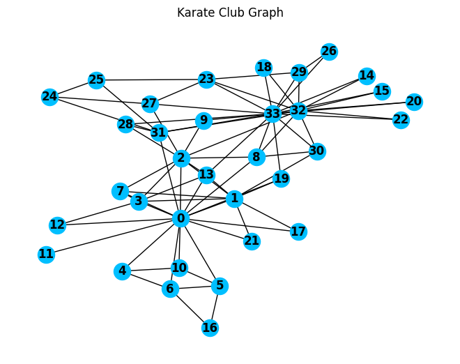
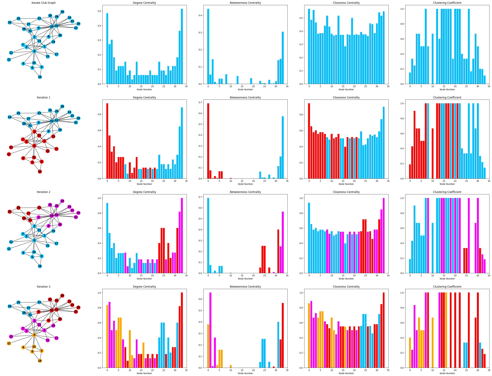

# Community Detection Using Modularity

A research assignment for the DSC 212 Graph Theory and Linear Algebra course involving community detection using modularity and recursive bi-partitioning,
demonstrated on the Karate Club Graph.

## Goal and Procedure

We want to identify how communities split and emerge from the standard Karate Club graph (34 nodes, 78 edges). This graph is undirected and has weights of 1 for this analysis.
We also evaluate parameters of centrality (Degree Centrality, Betweenness Centrality, Closeness Centrality, Clustering Coefficient) for every community partition, and plot their trends.
The algorithm decides to recursively partition the graph until Modularity Score Delta (Q) nears 0 for any community.

## Results 

## References

Methodology:
<i>Newman (2006), “Modularity and community structure in networks,” PNAS 103(23):8577–8582.</i>

## AI Usage Disclosure

AI was used for improving understanding of modularity and community detection theory. And for `networkx` library documentation lookups. 
No AI was used for problem solving, writing code or plot generation.
